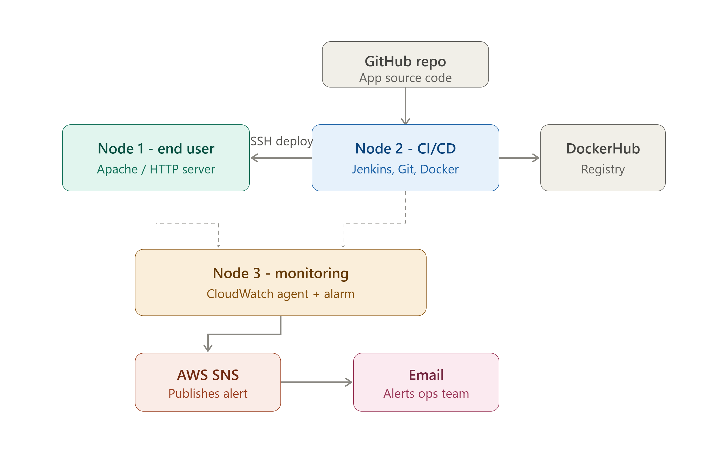
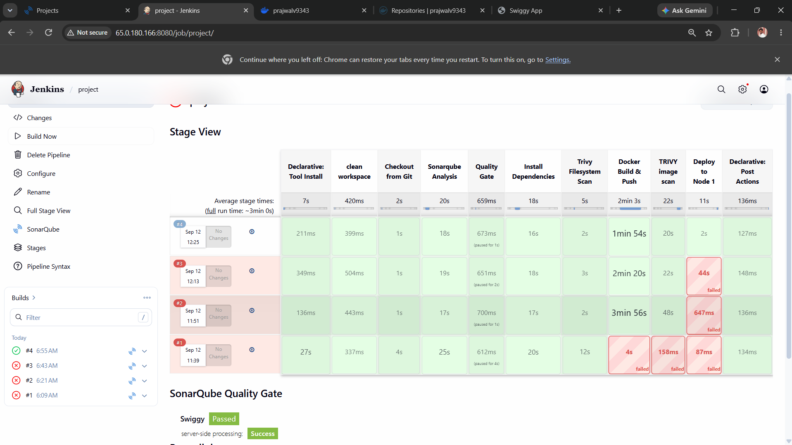
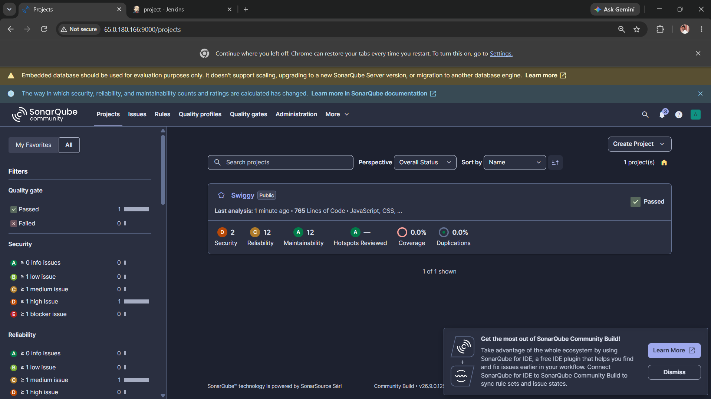
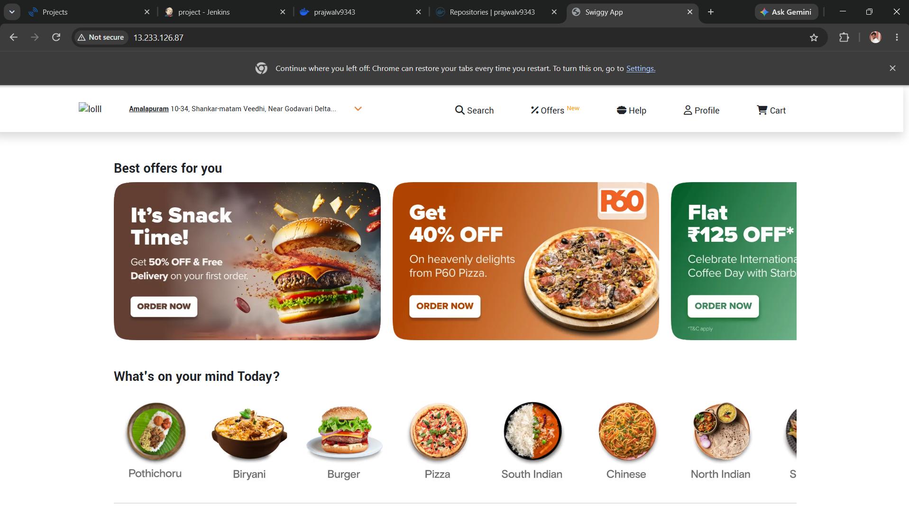
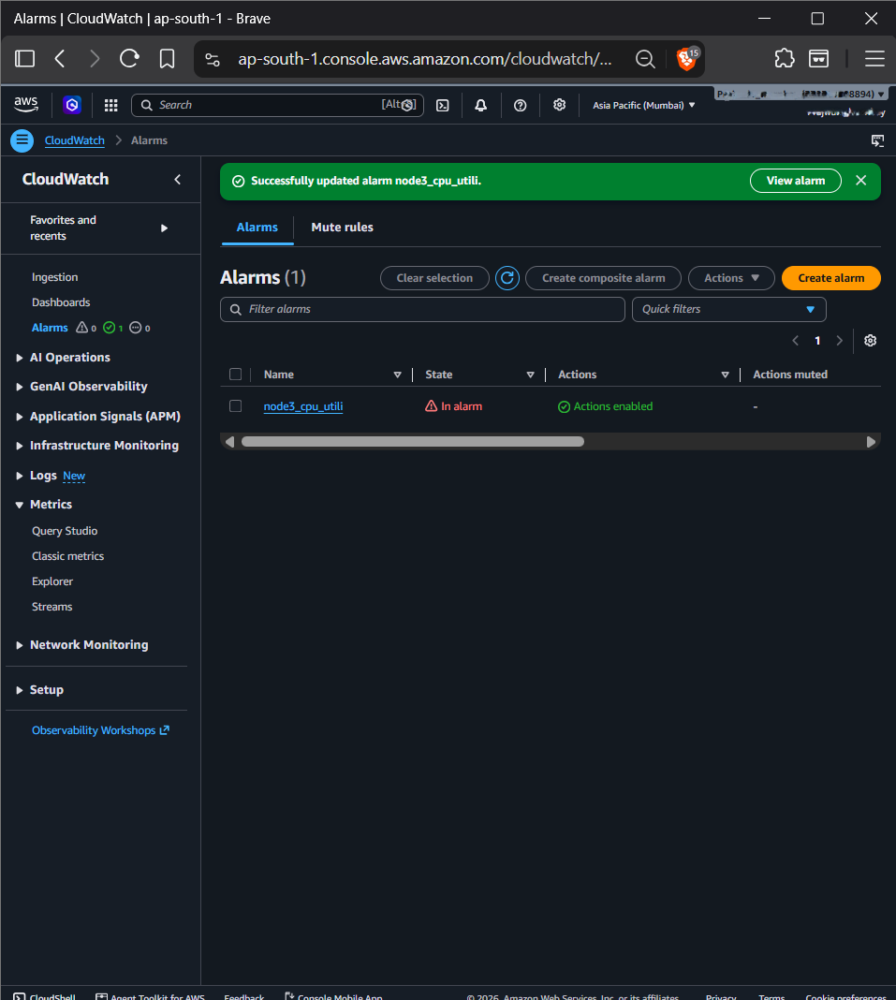

# End-to-End DevOps Project on AWS: Terraform, Jenkins, SonarQube, Trivy & Docker

A complete CI/CD workflow on AWS. Infrastructure is provisioned as code with Terraform, and a Jenkins pipeline takes a Node.js application (a Swiggy-style food delivery front end) through static analysis, a quality gate, vulnerability scanning, a versioned Docker build, and automated deployment. CloudWatch and SNS provide monitoring and email alerting.

## Architecture



| Node | Role | Key software |
|---|---|---|
| Node 1 | End-user web tier | Apache / HTTP server |
| Node 2 | CI/CD server and app host | Jenkins, SonarQube, Docker, Trivy, Git |
| Node 3 | Monitoring | CloudWatch agent, CloudWatch alarm, SNS email alerts |

All three nodes are EC2 instances provisioned by Terraform inside one VPC.

## Tech stack

- **Infrastructure as Code:** Terraform
- **Cloud:** AWS EC2, EBS, VPC security groups, IAM, CloudWatch, SNS
- **CI/CD:** Jenkins (declarative pipeline)
- **Code quality:** SonarQube Community Build with a Quality Gate
- **Security scanning:** Trivy (filesystem and image scans)
- **Containers:** Docker, DockerHub
- **Application:** Node.js

## Pipeline stages

| # | Stage | What it does |
|---|---|---|
| 1 | Clean Workspace | Removes files left over from the previous build |
| 2 | Checkout from Git | Pulls the application source from GitHub |
| 3 | SonarQube Analysis | Runs sonar-scanner and uploads results |
| 4 | Quality Gate | Waits for SonarQube's pass/fail result via webhook and aborts on failure |
| 5 | Install Dependencies | Runs `npm install` |
| 6 | Trivy Filesystem Scan | Scans source and dependencies for HIGH/CRITICAL CVEs |
| 7 | Docker Build & Push | Builds the image and pushes it to DockerHub with a version tag |
| 8 | Trivy Image Scan | Scans the built image |
| 9 | Deploy | Replaces the running container with the new version |

## Image versioning and rollback

Each build is tagged from the Jenkins build counter (`1.0`, `2.0`, `3.0`, ...) instead of overwriting a single `latest` tag.

```groovy
environment {
    APP_VERSION = "${env.BUILD_NUMBER}.0"
}
```

Every build leaves a pinned, immutable image on DockerHub, so rolling back is a single command:

```bash
docker rm -f swiggy
docker run -d --name swiggy -p 3000:3000 <dockerhub-user>/swiggy:<previous-version>
```

## Infrastructure (Terraform)

The `terraform/` directory is split by concern (`provider.tf`, `variables.tf`, `main.tf`, `outputs.tf`) and includes these practices:

- AMI resolved dynamically with a data source instead of a hardcoded ID
- Security groups use `vpc_security_group_ids` and scope SSH, Jenkins (8080) and SonarQube (9000) to an admin IP variable instead of `0.0.0.0/0`
- IMDSv2 enforced on every instance
- Encrypted gp3 root volumes, sized per node
- Provider and Terraform versions pinned
- Common tags applied to every resource
- Private and public IPs exposed as outputs
- `terraform.tfvars` and state files excluded from git

## Monitoring and alerting

- CloudWatch agent collects memory and disk metrics (namespace `CWAgent`)
- CloudWatch alarm on `CPUUtilization` publishes to an SNS topic
- SNS emails the subscribed address when the threshold is breached
- Instances authenticate through an IAM role with `CloudWatchAgentServerPolicy`, so no access keys live on the servers

## Getting started

**Prerequisites:** AWS account, AWS CLI configured, Terraform >= 1.6, an existing EC2 key pair, a DockerHub account.

```bash
git clone https://github.com/<your-username>/<repo-name>.git
cd <repo-name>/terraform

cp terraform.tfvars.example terraform.tfvars
# edit terraform.tfvars: set admin_cidr to your IP (curl -s ifconfig.me) plus /32

terraform init
terraform plan
terraform apply -auto-approve
```

Then, on Node 2:

1. Install Java, Jenkins, Docker and Trivy; run SonarQube as a container
2. Install the Jenkins plugins: Eclipse Temurin, Pipeline Stage View, SonarQube Scanner, NodeJS, Docker (Common / Pipeline / API)
3. Configure tools under Manage Jenkins -> Tools (`jdk17`, `sonar-scanner`, Node.js)
4. Add credentials: `sonar-token` (secret text) and `docker-creds` (username and password)
5. Register the SonarQube server as `sonar-server` and add the webhook `http://<jenkins-ip>:8080/sonarqube-webhook/`
6. Create a Pipeline job from the `Jenkinsfile` in this repo and click **Build Now**

When you're finished, clean up to avoid charges:

```bash
terraform destroy
```

## Screenshots

| Pipeline stage view | SonarQube quality gate |
|---|---|
|  |  |

| Live application | CloudWatch alarm and SNS email |
|---|---|
|  |  |

## Challenges and learnings

**SonarQube container killed by the OOM killer.** SonarQube disappeared mid-pipeline. `docker ps -a` showed it had exited, and `dmesg | grep -i "killed process"` confirmed the kernel had killed its Java process, because Jenkins, SonarQube and an active build were competing for memory on one instance. I capped SonarQube's JVM heap sizes, added swap as a buffer, and resized the instance. Checking system state before touching configuration saved me from debugging Jenkins settings that were never the problem.

**Docker login failing with "client version 1.29 is too old".** Jenkins' "install automatically" Docker tool had downloaded a years-old Docker client that the modern daemon on the host rejected, even though my credentials were correct. Removing the auto-installer so Jenkins used the system Docker fixed it.

**Key takeaway:** most failures looked like misconfiguration but were resource or environment issues. Reading logs first (`journalctl`, `dmesg`, `docker logs`, `df -h`, `free -h`) was faster than guessing.

## Possible improvements

- Application Load Balancer and Auto Scaling Group in front of the app tier
- Remote Terraform state (S3 backend with DynamoDB locking)
- Parameterized Jenkins rollback job
- Slack or email notifications from the pipeline

## License

MIT
